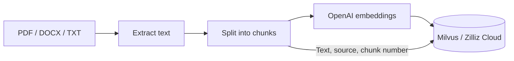
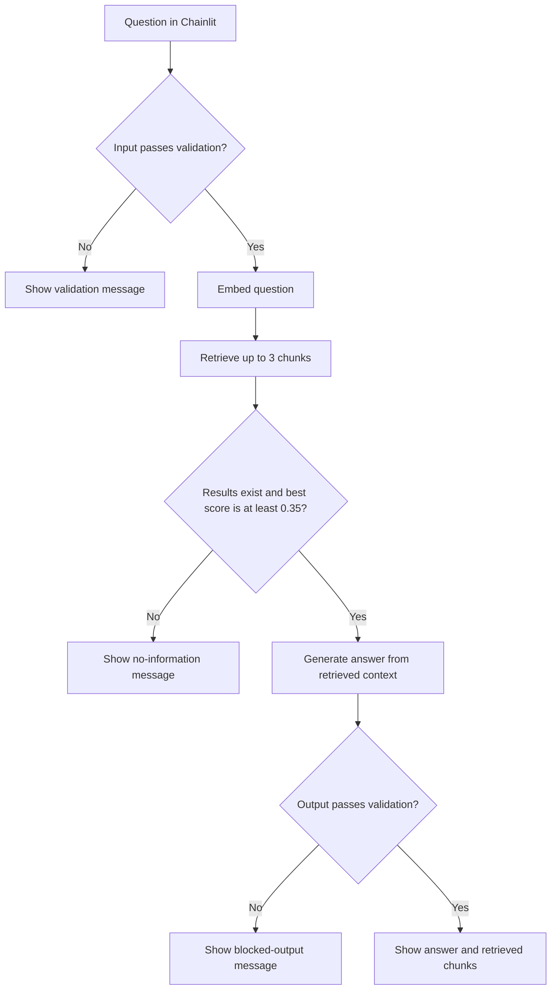

# RAG Chatbot

**Ask questions about your documents using semantic search and context-grounded AI answers.**

RAG Chatbot is a Python document assistant built with **Chainlit**, **OpenAI**, and **Milvus / Zilliz Cloud**. It retrieves relevant document passages, passes them to a language model, and displays the answer alongside the retrieved chunks so users can inspect the supporting text.

The project implements a retrieval-augmented generation (RAG) workflow with separate services for embeddings, vector storage, retrieval, answer generation, and basic input/output validation.

> **Setup status:** The supplied source includes the chat application and document-processing utilities, but does not include the `config.py` module imported by the services or a standalone ingestion script. This README provides both as copyable setup examples. Complete those steps and index documents before starting a fresh installation.

## Contents

- [Features](#features)
- [How it works](#how-it-works)
- [Technology stack](#technology-stack)
- [Project structure](#project-structure)
- [Prerequisites](#prerequisites)
- [Getting started](#getting-started)
- [Indexing documents](#indexing-documents)
- [Running the chatbot](#running-the-chatbot)
- [Usage](#usage)
- [Configuration and tuning](#configuration-and-tuning)
- [Vector collection schema](#vector-collection-schema)
- [Verification](#verification)
- [Troubleshooting](#troubleshooting)
- [Data handling](#data-handling)
- [Known limitations](#known-limitations)
- [Roadmap](#roadmap)
- [Contributing](#contributing)
- [License](#license)

## Features

| Capability | Implementation |
| --- | --- |
| Browser chat interface | Chainlit message and chat-start handlers |
| Document readers | Extract text from `.pdf`, `.docx`, and UTF-8 `.txt` files |
| Text chunking | Group sentences into chunks targeting approximately 500 characters |
| Semantic retrieval | Generate query embeddings and search a Milvus collection using cosine similarity |
| Context-grounded generation | Instruct the model to answer using only the retrieved context |
| Retrieval threshold | Skip answer generation when the best match scores below `0.35` |
| Supporting passages | Append retrieved chunk numbers and full chunk text to accepted answers |
| Basic guardrails | Reject empty input and block configured keyword substrings in inputs and model outputs |
| Modular services | Keep document processing, retrieval, storage, and generation separate |

Document readers are available as Python utilities. The indexing example below connects them into an ingestion workflow; chat attachments are not automatically indexed by the application.

## How it works

### Document preparation



### Question answering



The retrieval gate checks the **best** match. Once it passes, all returned chunks are included in the model context; the threshold is not applied separately to each chunk.

The generation prompt requests this fallback when the retrieved context does not contain the answer:

> I don't have this information stored in my database.

This prompt expresses the intended behavior. Retrieval and prompting do not guarantee that every generated answer is correct.

## Technology stack

| Component | Technology | Purpose |
| --- | --- | --- |
| Application | Python | Service logic and document processing |
| Chat UI | Chainlit | Browser interface and message lifecycle |
| Model API | OpenAI Python SDK | Embeddings and Chat Completions |
| Vector database | Milvus / Zilliz Cloud | Store document chunks and search embeddings |
| Database SDK | PyMilvus | Connections, collections, inserts, and searches |
| PDF parsing | PyPDF2 | Extract text from PDF pages |
| Word parsing | python-docx | Extract paragraph text from DOCX files |
| Environment loading | python-dotenv | Load the local `.env` file through the configuration example |

`requirements.txt` also lists NumPy, pandas, tqdm, and `dotenv`. Dependency versions are currently unpinned.

## Project structure

The extracted application source has the following layout:

```text
RAG Chatbot/
├── app.py                         # Chainlit entry point and request pipeline
├── requirements.txt               # Python dependencies
├── chainlit.md                    # Chainlit welcome-screen content
├── .chainlit/
│   ├── config.toml                 # UI and framework settings
│   └── translations/               # Chainlit interface translations
├── data/
│   └── docs/
│       └── AnimalFarm.pdf           # Bundled document
├── services/
│   ├── __init__.py
│   ├── embedding_service.py        # OpenAI embedding requests
│   ├── guardrails.py               # Input and output keyword checks
│   ├── llm_service.py              # Context-grounded answer generation
│   ├── milvus_service.py           # Vector collection management and search
│   └── search_service.py           # Context and source assembly
└── utilities/
    ├── __init__.py
    ├── chunker.py                  # Sentence-based text splitting
    └── reader.py                   # TXT, DOCX, and PDF extraction
```

The setup instructions below ask you to create three local files beside `app.py`: `config.py`, `.env`, and `ingest_documents.py`. They are not present in the supplied source snapshot.

## Prerequisites

- Python and `pip`; Python **3.11** is a suggested starting environment, rather than a tested compatibility guarantee.
- Git, or a downloaded copy of the repository.
- An OpenAI API key with access to the configured embedding and chat models.
- A reachable Milvus or Zilliz Cloud deployment with a connection URI and token.
- Documents containing extractable text.

The app requires network access to OpenAI and the vector database. API and hosting usage may incur charges under the respective accounts.

## Getting started

### 1. Get the source

```bash
git clone https://github.com/Basma-Yasmine/RAG-Chatbot.git
cd RAG-Chatbot
```

If the checkout contains `RAG Chatbot.zip` instead of the extracted Python files, extract it first:

```bash
unzip "RAG Chatbot.zip"
cd "RAG Chatbot"
```

On Windows, use **Extract All** for the archive, then open a terminal in the extracted `RAG Chatbot` directory.

Run all remaining application commands from the directory containing `app.py` and `requirements.txt`.

### 2. Create a virtual environment

**macOS / Linux**

```bash
python3 -m venv .venv
source .venv/bin/activate
python -m pip install --upgrade pip
python -m pip install -r requirements.txt
```

**Windows PowerShell**

```powershell
py -m venv .venv
.\.venv\Scripts\Activate.ps1
python -m pip install --upgrade pip
python -m pip install -r requirements.txt
```

### 3. Prepare the vector database

For Zilliz Cloud, copy your cluster's public endpoint and an API key or supported cluster credential into the environment settings below. The token must have permission to use the collection and, for a fresh setup, create and populate it. See the [official Zilliz connection guide](https://docs.zilliz.com/docs/connect-to-serving-cluster).

`MilvusService` creates the configured collection if it does not exist and reuses it otherwise. An existing collection must match the [expected schema](#vector-collection-schema), embedding dimension, and cosine search metric. The service does not migrate an incompatible collection.

### 4. Create `.env`

Create a file named `.env` beside `app.py`:

```dotenv
OPENAI_API_KEY=replace-with-your-openai-api-key
EMBEDDING_MODEL=text-embedding-3-small
LLM_MODEL=gpt-4o-mini

MILVUS_URI=https://replace-with-your-cluster-endpoint
MILVUS_TOKEN=replace-with-your-milvus-or-zilliz-token
MILVUS_COLLECTION=rag_documents
EMBEDDING_DIM=1536
```

These model names are **example settings**, not defaults supplied by the existing application. `text-embedding-3-small` returns 1,536 dimensions by default, which matches the example collection configuration. See the [OpenAI embeddings guide](https://developers.openai.com/api/docs/guides/embeddings#how-to-get-embeddings). The example chat model supports the Chat Completions endpoint used by `llm_service.py`; see the [GPT-4o Mini model documentation](https://developers.openai.com/api/docs/models/gpt-4o-mini).

Use the same embedding model for ingestion and retrieval. Changing models requires re-embedding the documents, even when the new model produces the same vector dimension.

### 5. Create `config.py`

The services import settings from a root-level `config` module. Create `config.py` beside `app.py` with the following contents:

```python
import os
from pathlib import Path

from dotenv import load_dotenv


load_dotenv(Path(__file__).resolve().parent / ".env")


def required(name):
    value = os.getenv(name, "").strip()
    if not value:
        raise ValueError(f"Missing required environment variable: {name}")
    return value


OPENAI_API_KEY = required("OPENAI_API_KEY")
MILVUS_URI = required("MILVUS_URI")
MILVUS_TOKEN = required("MILVUS_TOKEN")

EMBEDDING_MODEL = os.getenv("EMBEDDING_MODEL", "text-embedding-3-small")
LLM_MODEL = os.getenv("LLM_MODEL", "gpt-4o-mini")
MILVUS_COLLECTION = os.getenv("MILVUS_COLLECTION", "rag_documents")
EMBEDDING_DIM = int(os.getenv("EMBEDDING_DIM", "1536"))

if EMBEDDING_DIM <= 0:
    raise ValueError("EMBEDDING_DIM must be a positive integer")
```

In this example, variables already set in the process environment take precedence over `.env`. Keep credentials in environment variables rather than Python source.

### 6. Exclude local files from Git

Add the following entries to the repository's `.gitignore`, preserving any existing rules:

```gitignore
.env
.env.*
!.env.example
.venv/
venv/
__pycache__/
*.py[cod]
.files/
.DS_Store
```

Keep private documents out of Git as well. A `.gitignore` rule does not remove files already tracked by Git.

## Indexing documents

Starting the chat app creates or opens a collection; it does **not** read or index `data/docs/`. A new collection must be populated before it can answer document questions.

Place supported documents in `data/docs/`. The supplied source contains `data/docs/AnimalFarm.pdf`.

### Create the ingestion helper

Create `ingest_documents.py` beside `app.py` using this example. It uses the existing readers, chunker, embedding service, and insertion method, and scans `data/docs/` recursively.

```python
from pathlib import Path

from config import EMBEDDING_DIM
from services.embedding_service import get_embeddings
from services.milvus_service import MilvusService
from utilities.chunker import split_text
from utilities.reader import read_document


DOCS_DIR = Path(__file__).resolve().parent / "data" / "docs"
SUPPORTED_EXTENSIONS = {".pdf", ".docx", ".txt"}
EMBEDDING_BATCH_SIZE = 64


def main():
    paths = sorted(
        path
        for path in DOCS_DIR.rglob("*")
        if path.is_file() and path.suffix.lower() in SUPPORTED_EXTENSIONS
    )

    if not paths:
        raise SystemExit(f"No supported documents found in {DOCS_DIR}")

    database = MilvusService()
    inserted = 0

    for path in paths:
        text = read_document(str(path))
        chunks = [chunk for chunk in split_text(text) if chunk.strip()]

        if not chunks:
            print(f"Skipped {path.name}: no extractable text")
            continue

        source = path.relative_to(DOCS_DIR).as_posix()

        for start in range(0, len(chunks), EMBEDDING_BATCH_SIZE):
            batch = chunks[start:start + EMBEDDING_BATCH_SIZE]
            vectors = get_embeddings(batch)

            if len(vectors) != len(batch):
                raise ValueError("Embedding count does not match chunk count")
            if any(len(vector) != EMBEDDING_DIM for vector in vectors):
                raise ValueError("Embedding dimension does not match EMBEDDING_DIM")

            metadatas = [
                {"source": source, "chunk": start + offset + 1}
                for offset in range(len(batch))
            ]

            database.insert_documents(batch, vectors, metadatas)
            inserted += len(batch)

        print(f"Indexed {path.name}: {len(chunks)} chunks")

    database.collection.flush()
    print(f"Inserted {inserted} chunks in this run")
    print(f"Collection contains {database.get_total_vectors()} vectors")


if __name__ == "__main__":
    main()
```

Run it with the virtual environment active:

```bash
python ingest_documents.py
```

The helper makes OpenAI embedding requests and writes vectors, text, source paths, and chunk numbers to the database. It uses batches of 64 texts for embeddings; `insert_documents()` separately supports database insertion batches of up to 128 records by default.

**Ingestion is append-only.** Rerunning this example inserts duplicate chunks, and an interrupted run can leave a partially indexed dataset. There is no deduplication, resume tracking, or automatic removal of old document versions. For a clean rebuild, choose a new `MILVUS_COLLECTION` name and index into that collection, then restart the chat app. This preserves the previous collection.

The existing splitter targets 500 characters and does not impose a strict maximum on individual sentences. Very long sentences may need additional splitting to fit embedding input limits. Scanned PDFs need OCR before the supplied PDF reader can use their contents.

## Running the chatbot

After configuring the app and indexing documents:

```bash
chainlit run app.py -w
```

Open [http://localhost:8000](http://localhost:8000). The `-w` option enables reloads during development, as described in the [Chainlit Python quickstart](https://docs.chainlit.io/get-started/pure-python).

To use another port:

```bash
chainlit run app.py -w --port 8001
```

To bind explicitly to the local machine without watch mode:

```bash
chainlit run app.py --host 127.0.0.1 --port 8000
```

Stop the server with `Ctrl+C`. See [Chainlit's CLI reference](https://docs.chainlit.io/backend/command-line) for supported options.

## Usage

1. Start a chat session in the browser.
2. Ask a specific question about a document already indexed in the collection.
3. Read the answer and review the text under **Retrieved Chunks**.
4. If the answer is unavailable, verify the indexed content or rephrase the question using details from the document.

For the bundled document, example questions to try after indexing include:

- Who is Napoleon?
- What role does Snowball play in the story?
- How are the pigs described in the document?

Actual answers depend on extraction quality, the indexed chunks, retrieval scores, and the configured model.

Accepted responses use this general layout:

```text
<Generated answer>

Retrieved Chunks:

Chunk <number>

<Retrieved document text>

---

Chunk <number>

<Retrieved document text>
```

Source filenames and scores are available in retrieval metadata, but the current chat response displays only chunk numbers and text. Chunk numbers restart per document in the ingestion example, so they do not uniquely identify a passage across multiple files.

Attaching a file in the Chainlit UI does not add it to the collection. Add documents through the ingestion workflow instead.

## Configuration and tuning

### Environment settings

The defaults below come from the `config.py` example in this README.

| Variable | Required | Example / default | Purpose |
| --- | --- | --- | --- |
| `OPENAI_API_KEY` | Yes | Your API key | Authenticate embedding and chat requests |
| `MILVUS_URI` | Yes | Your cluster endpoint | Connect to the vector database |
| `MILVUS_TOKEN` | Yes | Your API key or connection token | Authenticate the database connection |
| `MILVUS_COLLECTION` | No | `rag_documents` | Collection used for ingestion and retrieval |
| `EMBEDDING_MODEL` | No | `text-embedding-3-small` | Embedding model for both documents and questions |
| `EMBEDDING_DIM` | No | `1536` | Vector dimension in the collection schema |
| `LLM_MODEL` | No | `gpt-4o-mini` | Model used to generate answers |

Changing `EMBEDDING_DIM` changes the schema expected for a **new** collection. It does not resize embeddings or modify an existing collection. `embedding_service.py` does not pass a custom `dimensions` parameter to OpenAI.

### Settings in source code

| Setting | Current value | Location | Effect |
| --- | --- | --- | --- |
| Similarity threshold | `0.35` | `app.py` | Minimum best-match cosine score before generation |
| Retrieval count | `3` | `services/search_service.py` | Maximum chunks requested for the context |
| Default chunk target | `500` characters | `utilities/chunker.py` | Approximate text size before embedding |
| Requested index type | `IVF_FLAT` | `services/milvus_service.py` | Index configuration sent when creating a collection |
| Requested index partitions | `nlist=128` | `services/milvus_service.py` | IVF index build parameter |
| Requested search probes | `nprobe=10` | `services/milvus_service.py` | IVF search parameter |
| Insert batch size | `128` | `services/milvus_service.py` | Maximum records per insertion batch by default |
| Generation temperature | `0` | `services/llm_service.py` | Requests low-variation model output |
| Restricted substrings | `api_key`, `password`, `secret`, `system prompt` | `services/guardrails.py` | Case-insensitive input and output keyword checks |

Tune the similarity threshold using representative questions and passages. A cosine similarity score is not a calibrated probability or confidence percentage.

**Zilliz index behavior:** Although the code requests `IVF_FLAT`, Zilliz Cloud documents that it automatically applies `AUTOINDEX` to migrated Milvus index creation. Effective cloud index behavior can therefore differ from these source settings. See [Zilliz AUTOINDEX documentation](https://docs.zilliz.com/docs/autoindex-explained).

### UI customization

- Edit `chainlit.md` to replace the default welcome screen.
- Edit `.chainlit/config.toml` to change the assistant name, theme settings, and framework features.
- The supplied config enables attachment controls, while `app.py` only processes message text.

## Vector collection schema

`MilvusService.create_collection()` defines the following fields:

| Field | Type | Details |
| --- | --- | --- |
| `id` | `INT64` | Primary key generated automatically |
| `embedding` | `FLOAT_VECTOR` | Dimension set by `EMBEDDING_DIM` |
| `text` | `VARCHAR` | Stored document chunk; configured maximum length `65535` |
| `source` | `VARCHAR` | Document source; configured maximum length `512` |
| `chunk` | `INT64` | Chunk identifier supplied during ingestion |

Search requests use the `embedding` field and return text, source, chunk number, and a cosine similarity score. Page numbers and character offsets are not stored.

## Verification

The supplied source has no automated test suite. Use the following checks after completing setup.

### Check installed dependencies and configuration

```bash
python -m pip check
python -c "import config; print('Configuration loaded successfully')"
```

The configuration check loads local settings without printing credentials. It does not verify remote access or model availability.

### Check indexing and retrieval

The ingestion helper prints the number of chunks inserted and the collection's vector count. For a focused retrieval check, run the following in a Python session started from the application directory:

```python
from services.milvus_service import MilvusService
from services.search_service import retrieve_context

database = MilvusService()
context, sources = retrieve_context("Who is Napoleon?", database)

print("Retrieved chunks:", len(sources))
for source in sources:
    print(source["source"], source["chunk"], source["score"])
```

This check calls the embedding API and searches the database. Confirm that the returned passages actually address the question.

### Check the chat behavior

| Check | What to verify |
| --- | --- |
| Question answerable from an indexed document | A relevant answer appears with retrieved chunk text |
| Question outside the collection's subject | The app declines when no results exist or the best score is below `0.35`; when retrieval passes, inspect whether the model follows the fallback prompt |
| Input containing `password` | The app displays an input-validation message |
| Restart with the same collection name | Previously indexed documents remain available |

The no-information path is partly prompt-based, so an unrelated question is also a useful quality check rather than a guaranteed refusal test.

## Troubleshooting

| Symptom | Likely cause | What to do |
| --- | --- | --- |
| `ModuleNotFoundError: No module named 'config'` | The required configuration module is missing or the app is launched from the wrong location | Create `config.py` beside `app.py` and run commands from that directory |
| Missing environment-variable error | A required setting is absent or empty | Check `.env`, its location, and any overriding shell variables |
| `chainlit: command not found` | The virtual environment is inactive or installation failed | Activate `.venv` and install `requirements.txt` in that environment |
| OpenAI authentication or model-access error | Invalid credentials or unavailable model access | Verify the API key and the models available to its project |
| OpenAI rate-limit or quota error | API rate limits or account usage limits | Check the account's usage and limits; reduce requests or add retry/backoff behavior |
| Cannot connect to Milvus / Zilliz | Incorrect URI, token, permissions, or network access | Verify the cluster endpoint and credentials and confirm that the deployment is reachable |
| Vector-dimension mismatch | Model output and collection schema differ | Align `EMBEDDING_MODEL` and `EMBEDDING_DIM`, then re-index into a compatible collection |
| Collection-field or metric error | An existing collection uses another schema or metric | Use a new collection name with this project's schema and cosine metric |
| No useful answers after startup | Empty collection, wrong collection name, extraction issues, or weak retrieval scores | Run ingestion and inspect retrieved text and scores |
| Index or search parameter error | Deployment-specific index requirements | Inspect the effective index; for Zilliz, use the documented AUTOINDEX build/search settings when adapting the service |
| PDF text is empty or extraction raises an error | Scanned pages, unsupported PDF content, or pages without extractable text | OCR or convert the document first; the current reader does not handle every PDF extraction case |
| Legitimate text is blocked | A restricted keyword appears as a substring | Review `RESTRICTED_KEYWORDS` and adjust the rules for the document domain |
| Repeated passages in retrieval | The same documents were indexed more than once | Build a fresh collection or implement deduplication |
| Uploading a file has no effect | The chat handler does not ingest attachments | Run the ingestion helper with the file under `data/docs/` |
| Port `8000` is already in use | Another process is listening on the default port | Start with `--port 8001` |

## Data handling

- Document chunks are sent to OpenAI to generate embeddings.
- Each accepted question is sent to OpenAI for an embedding; questions that pass the retrieval gate are also sent with retrieved context for answer generation.
- Milvus / Zilliz stores document text, embeddings, source identifiers, and chunk numbers.
- The chat interface displays retrieved text, so users can see passages from the configured collection.
- The app defines no document-level access filters, authentication callbacks, or tenant isolation.
- The keyword checks are basic validation rules and do not provide comprehensive secret detection or prompt-injection protection.

Use documents you are authorized to process, keep credentials out of source control, and configure appropriate access controls before making the app available to other users.

## Known limitations

- **Manual setup is required:** `config.py` and the ingestion entry point must be created using the examples above or equivalent implementations.
- **No automatic uploads or indexing:** Chat attachments and files placed in `data/docs/` are not processed by `app.py`.
- **Limited extraction:** PDF parsing has no OCR or page-level citations; DOCX extraction reads paragraphs rather than a complete representation of tables and other document elements.
- **Simple chunking:** The splitter uses sentence-like separators, targets characters rather than tokens, and has no overlap or strict limit for long sentences.
- **No ingestion lifecycle:** Inserts do not deduplicate, update, or remove earlier document versions.
- **Basic retrieval:** There is no reranking, hybrid keyword search, document filtering, or separate relevance check for each returned chunk.
- **Incomplete source display:** The UI shows chunk text and numbers, but omits filenames, scores, and page references.
- **No conversational memory in the app:** `generate_answer()` accepts optional history, but the message handler does not pass history to it.
- **Fallback normalization issue:** The post-generation check compares a string containing an uppercase `I` against `answer.lower()`. That check never matches as written, so it does not normalize the model's fallback to the separate `I can't provide this information.` message.
- **Shared state and synchronous calls:** The database service is stored in a module global, and synchronous API/database calls run inside an async message handler. Concurrent-user behavior needs further work.
- **Operational features are absent:** The app has no custom request retry handling, response streaming, automated tests, dependency lockfile, or deployment configuration.

## Roadmap

Potential improvements, rather than current features:

- Package validated configuration and ingestion commands with the source.
- Add document deduplication, versioning, deletion, and resumable indexing.
- Support uploads through the chat interface.
- Preserve filenames and page references in displayed citations.
- Add token-aware chunking, overlap, and OCR support.
- Evaluate reranking and hybrid retrieval against a representative question set.
- Add conversation history and improve fallback handling.
- Move blocking work out of async handlers and isolate session state.
- Add authentication, collection access rules, tests, dependency pinning, and deployment examples.

## Contributing

Bug reports and pull requests can be submitted through [Basma-Yasmine/RAG-Chatbot](https://github.com/Basma-Yasmine/RAG-Chatbot).

1. Fork the repository and create a branch for your change.
2. Keep changes focused and describe the behavior they improve.
3. Run `python -m pip check` and the relevant verification steps above. If a change affects retrieval or generation, describe the documents and questions used to evaluate it.
4. Open a pull request with a concise description and verification results.

Exclude API credentials and private documents from commits and issue reports.

## License

No project license file is included in the supplied source snapshot. Add a `LICENSE` file to define the intended reuse and distribution terms. Third-party dependencies and bundled documents retain their own applicable terms.
